<p align="center">
  
</p>

<h1 align="center">UniBus</h1>
<p align="center"><b>University Bus Booking System</b></p>

<p align="center">
  
  
  
  
</p>

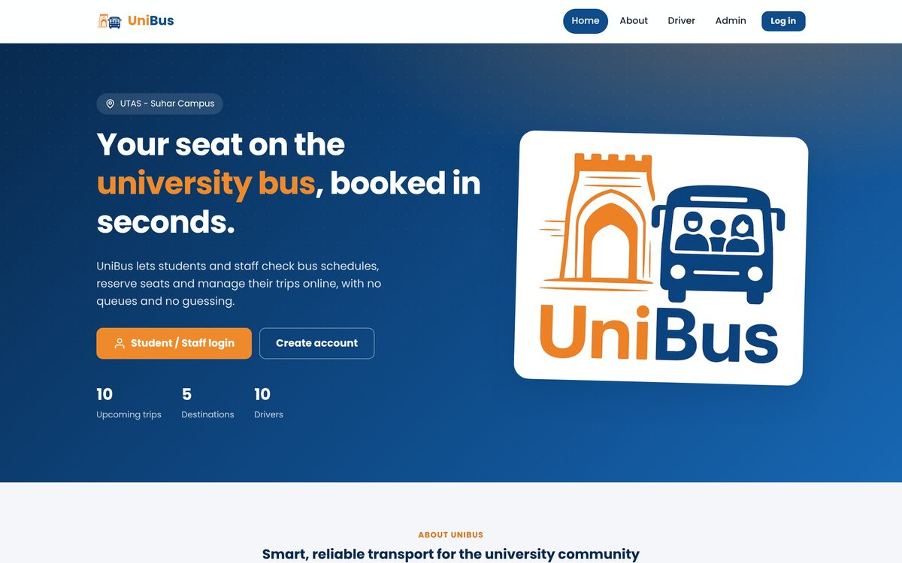

---

## Table of Contents

1. [Overview](#1-overview)
2. [Features](#2-features)
3. [Technologies](#3-technologies)
4. [Requirements](#4-requirements)
5. [Installation and Setup](#5-installation-and-setup)
6. [Running the Project in VS Code](#6-running-the-project-in-vs-code)
7. [Demo Accounts](#7-demo-accounts)
8. [How to Use](#8-how-to-use)
9. [Project Structure](#9-project-structure)
10. [Database](#10-database)
11. [Configuration](#11-configuration)
12. [Security](#12-security)
13. [System Design](#13-system-design)
14. [Screenshots](#14-screenshots)
15. [Troubleshooting](#15-troubleshooting)
16. [Team](#16-team)

---

## 1. Overview

**UniBus** is a web-based platform for managing university bus transportation at the
University of Technology and Applied Sciences – Suhar Campus.

Students and staff use UniBus to view bus schedules, book seats online and manage their trips.
Drivers see their assigned trips and the list of passengers to pick up, and administrators
manage trips, drivers, bookings and user feedback from one dashboard.

The goal of UniBus is to reduce waiting times and overcrowding, avoid manual booking errors, and
improve communication between passengers and the transport office.

The system has three user roles:

| Role | Purpose |
|---|---|
| **Student / Staff** | Find trips, book seats, manage bookings and send feedback |
| **Driver** | View assigned trips and the passenger list |
| **Administrator** | Manage trips, drivers, administrators, bookings and feedback |

---

## 2. Features

### Students and staff
- Create an account with a secure password and log in
- View upcoming trips with date, time, bus number, driver and free seats
- Search trips by destination
- Book 1–5 seats in three steps: choose trip → enter seats and pickup location → choose payment
- Choose a payment method: cash on the bus or card
- View booking history with driver contact details
- Cancel an upcoming booking (seats are released automatically)
- Send feedback to the transport office

### Drivers
- Log in with full name and phone number
- View today's, upcoming and past trips
- See each passenger's name, phone number, number of seats and pickup location

### Administrators
- Dashboard with statistics: upcoming trips, active bookings, registered users, revenue and seat occupancy
- Insert, update and delete trips, and assign a driver to each trip
- View, search and filter all bookings
- Read and remove user feedback
- Add, edit and remove drivers
- Add and remove administrators, and change their own password

### General
- Responsive design for desktop, tablet and mobile
- Booking rules: no booking of departed or full trips, and no duplicate bookings of the same trip
- Seat counts are updated safely, so a trip can never be over-booked

---

## 3. Technologies

| Layer | Technology |
|---|---|
| Front-end | HTML5, CSS3, JavaScript |
| Back-end | PHP 8 |
| Database | SQLite 3 (accessed through PHP PDO) |
| Web server | PHP built-in development server |
| Code editor | Visual Studio Code |
| Font | Poppins (Google Fonts) |

The system follows a three-tier architecture: the browser (client), the PHP application (server)
and the SQLite database (data).

---

## 4. Requirements

| Software | Version | Purpose |
|---|---|---|
| **PHP** | 8.0 or newer | Runs the application and the web server |
| PHP extension **pdo_sqlite** | included with PHP | Database access |
| PHP extension **mbstring** | included with PHP | Text handling |
| **Visual Studio Code** | latest | Opening, editing and running the project |
| A web browser | Chrome, Edge, Firefox or Safari | Using the system |

No separate database server is required. The database is a single file that the application
creates automatically.

---

## 5. Installation and Setup

### Step 1 – Install Visual Studio Code

Download and install it from **https://code.visualstudio.com**.

### Step 2 – Install PHP

**Windows**

Open **PowerShell** and run:

```powershell
winget install PHP.PHP.8.3
```

Close PowerShell and open it again, then check the installation:

```powershell
php -v
```

**macOS**

```bash
brew install php
```

**Linux (Ubuntu / Debian)**

```bash
sudo apt install php-cli php-sqlite3 php-mbstring
```

### Step 3 – Enable the required PHP extensions (Windows only)

On Windows, the `pdo_sqlite` and `mbstring` extensions must be switched on once.
Paste the following into **PowerShell** and press Enter:

```powershell
$dir = Split-Path (php -r "echo PHP_BINARY;")
if (!(Test-Path "$dir\php.ini")) { Copy-Item "$dir\php.ini-development" "$dir\php.ini" }
(Get-Content "$dir\php.ini") `
  -replace '^;?\s*extension_dir\s*=\s*"ext"', "extension_dir = `"$dir\ext`"" `
  -replace '^;extension=pdo_sqlite', 'extension=pdo_sqlite' `
  -replace '^;extension=mbstring', 'extension=mbstring' |
  Set-Content "$dir\php.ini"
php -m | Select-String "pdo_sqlite|mbstring"
```

The output must show **`mbstring`** and **`pdo_sqlite`**.

<details>
<summary>Manual alternative</summary>

1. Find the PHP folder by running `php -r "echo PHP_BINARY;"`.
2. In that folder, copy `php.ini-development` and rename the copy to `php.ini`.
3. Open `php.ini` and change these lines (remove the `;` at the start):
   ```ini
   extension_dir = "C:\full\path\to\php\ext"
   extension=pdo_sqlite
   extension=mbstring
   ```
4. Save the file and run `php -m` to confirm both extensions are listed.
</details>

### Step 4 – Get the project

Extract the **UniBus** project folder to a location of your choice, for example `Documents\UniBus`.

---

## 6. Running the Project in VS Code

1. Open **Visual Studio Code**.
2. Select **File → Open Folder…** and choose the `UniBus` folder.
3. When VS Code suggests the recommended extensions (*PHP Intelephense*, *SQLite Viewer*), click **Install**.
   They are optional but make editing easier.
4. Open the terminal: **Terminal → New Terminal** (or press <kbd>Ctrl</kbd> + <kbd>`</kbd>).
5. Start the server:
   ```bash
   php -S localhost:8000
   ```
   You can also press <kbd>Ctrl</kbd> + <kbd>Shift</kbd> + <kbd>B</kbd> and choose **Run UniBus**.
6. Open **http://localhost:8000** in your browser.
7. To stop the server, click inside the terminal and press <kbd>Ctrl</kbd> + <kbd>C</kbd>.

On the first visit, the database `database/unibus.sqlite` is created automatically with demo data.

**Shortcut without VS Code:** double-click `start.bat` on Windows, or run `./start.sh` on macOS/Linux.

### Editing the project

Save a file (<kbd>Ctrl</kbd> + <kbd>S</kbd>) and refresh the browser to see the change.
The server does not need to be restarted.

| To change… | Edit |
|---|---|
| Colours, fonts and layout of all pages | `assets/css/style.css` |
| Navigation menu, logo and footer | `includes/header.php`, `includes/footer.php` |
| Contact email, seat price, seat limit | `includes/config.php` |
| Tables or demo data | `database/schema.sql` (then reset the database, see [Database](#10-database)) |

---

## 7. Demo Accounts

| Role | Login page | Username / Email | Password |
|---|---|---|---|
| Student | `/login.php` | `student@unibus.test` | `Student@123` |
| Staff | `/login.php` | `staff@unibus.test` | `Staff@123` |
| Administrator | `/admin_login.php` | `admin` | `Admin@123` |
| Driver | `/driver_login.php` | `Salim Al-Balushi` | `95123456` |

<details>
<summary>All driver accounts (name / phone number)</summary>

| Name | Phone |
|---|---|
| Salim Al-Balushi | 95123456 |
| Ahmed Al-Aufi | 95234567 |
| Khalid Al-Maamari | 95345678 |
| Maher Al-Hosni | 95456789 |
| Nasser Al-Sheedi | 95567890 |
| Fahad Al-Hinai | 95678901 |
| Hamed Al-Rashdi | 95789012 |
| Mansoor Al-Farsi | 95890123 |
| Talib Al-Kiyumi | 95901234 |
| Yousef Al-Saadi | 95012345 |
</details>

---

## 8. How to Use

### Booking a trip (student / staff)
1. Log in, or create an account with **Create account**.
2. Open **Trips** and pick a trip (use the search box or destination filters).
3. Click **Book now**, enter the number of seats and your pickup location.
4. Choose **Cash** or **Card** and click **Confirm booking**.
5. The confirmation page shows the booking number and the driver's phone number.
6. Open **My bookings** to see your trips or cancel an upcoming booking.

### Managing the system (administrator)
1. Log in at **Admin**.
2. **Dashboard** shows statistics and shortcuts.
3. **Trips**: insert, update or delete trips and assign drivers.
4. **Bookings** and **Feedback**: monitor passengers and messages.
5. **Drivers** and **Admins**: manage accounts.

### Viewing trips (driver)
1. Log in at **Driver** with full name and phone number.
2. **My trips** lists upcoming trips with each passenger's pickup location and phone number.

### Schedule
| Time | Direction |
|---|---|
| 8:00 AM, 10:00 AM | Home → University |
| 12:00 PM, 2:00 PM, 4:00 PM, 6:00 PM | University → Home |

---

## 9. Project Structure

```
UniBus/
├── index.php               Home page
├── login.php               Student / staff login
├── register.php            Create account
├── logout.php              Log out (all roles)
│
├── welcome.php             Student home page
├── view_trip.php           Available trips and search      (booking step 1)
├── booking.php             Seats and pickup location       (booking step 2)
├── confirm_booking.php     Summary and payment             (booking step 3)
├── thanks.php              Booking confirmation
├── history.php             My bookings
├── cancel_booking.php      Cancel a booking
├── feedback.php            Send feedback
│
├── driver_login.php        Driver login
├── driver_view.php         Driver trips and passenger list
│
├── admin_login.php         Administrator login
├── dashboard.php           Administrator dashboard
├── admin_view.php          All trips
├── insert.php              Add a trip
├── update.php              Edit a trip
├── delete.php              Delete a trip
├── admin_bookings.php      All bookings
├── admin_feedback.php      User feedback
├── admin_drivers.php       Manage drivers
├── admin_admins.php        Manage administrators
│
├── includes/
│   ├── config.php          Application settings
│   ├── db.php              Database connection and query helpers
│   ├── functions.php       Security, login checks, booking rules, formatting
│   ├── header.php          Shared page header and menu
│   ├── footer.php          Shared page footer
│   ├── auth_side.php       Side panel of the login pages
│   └── trip_form.php       Trip form used by insert and update
│
├── assets/
│   ├── css/style.css       Stylesheet for all pages
│   ├── js/app.js           Menu, confirmations and live price
│   └── img/                Logo and icon
│
├── database/
│   └── schema.sql          Tables and demo data
│
├── docs/
│   ├── diagrams/           System design diagrams
│   └── screenshots/        Screenshots
│
├── .vscode/                VS Code tasks and recommended extensions
├── start.bat               Start script (Windows)
└── start.sh                Start script (macOS / Linux)
```

---

## 10. Database

UniBus uses **SQLite**. The database file `database/unibus.sqlite` is created automatically from
`database/schema.sql` the first time the website is opened.

| Table | Description |
|---|---|
| `users` | Students and staff (name, email, phone, hashed password) |
| `admin` | Administrator accounts |
| `drivers` | Drivers (name and phone number) |
| `trips` | Trips: destination, date, time, bus number, driver, total and available seats |
| `booking` | Bookings: user, trip, seats, pickup location, payment method, price, status |
| `feedback` | Messages sent by users |

**Relationships**
- A user makes many bookings, and a trip has many bookings.
- A driver drives many trips, and an administrator manages many trips.
- A user writes many feedback messages.

**Reset the database:** stop the server, delete `database/unibus.sqlite`, start the server again
and refresh the page. A fresh copy with demo data is created.

**View the data:** with the *SQLite Viewer* extension, click `database/unibus.sqlite` in VS Code.

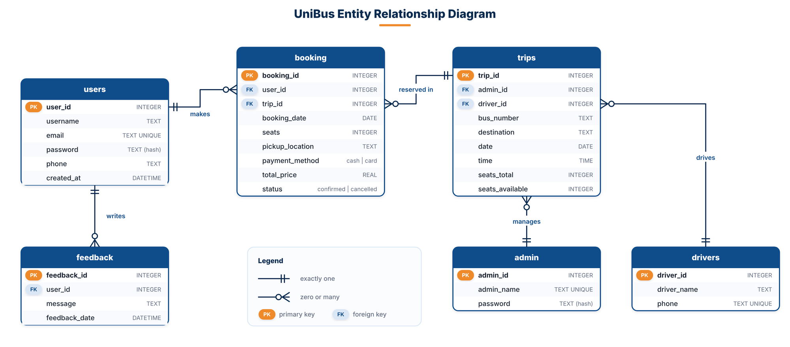

---

## 11. Configuration

Settings are in `includes/config.php`:

| Setting | Default | Description |
|---|---|---|
| `APP_NAME` | `UniBus` | Name shown in the browser tab |
| `CONTACT_EMAIL` | `support@unibus.com` | Email shown in the footer |
| `CAMPUS` | `UTAS - Suhar Campus` | Campus name |
| `SEAT_PRICE` | `1.0` | Price of one seat (OMR) |
| `MAX_SEATS_PER_BOOKING` | `5` | Maximum seats per booking |
| `DEBUG` | `true` | Shows PHP errors; set to `false` in production |

The time zone is set to `Asia/Muscat`.

---

## 12. Security

| Protection | How it is implemented |
|---|---|
| Password storage | Passwords are hashed with bcrypt (`password_hash` / `password_verify`) |
| Strong passwords | At least 8 characters with uppercase, lowercase, a number and a special character |
| SQL injection | All queries use PDO prepared statements |
| Cross-site scripting (XSS) | All output is escaped before it is displayed |
| Cross-site request forgery (CSRF) | Every form includes a secret token that is checked on submit |
| Access control | Every page checks the role (student, driver or administrator) |
| Sessions | Session ID is renewed at login; cookies are HTTP-only |
| Data integrity | Booking and seat updates run in a single database transaction |

---

## 13. System Design

| Architecture | Use case diagram |
|---|---|
| 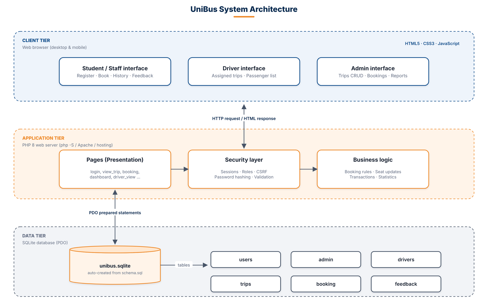 | 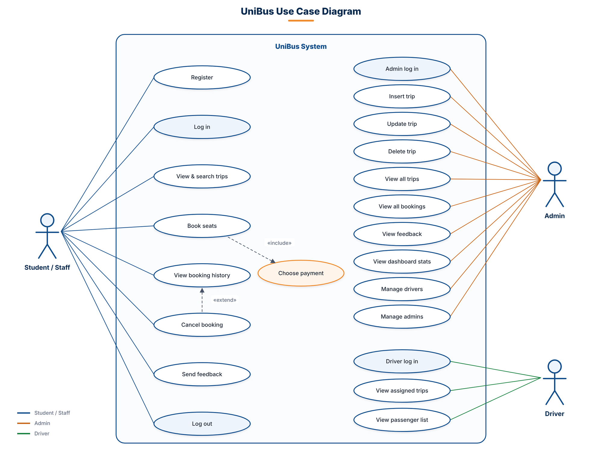 |
| **Context diagram** | **Data flow diagram (level 1)** |
| 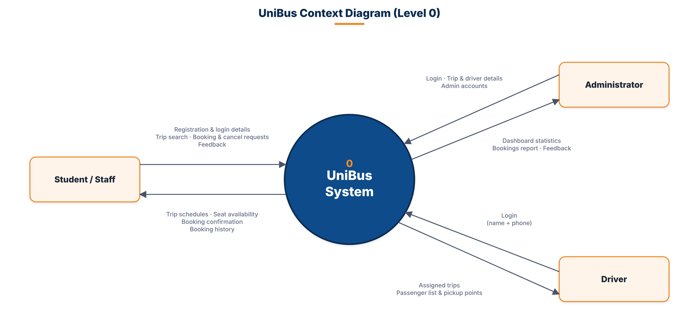 | 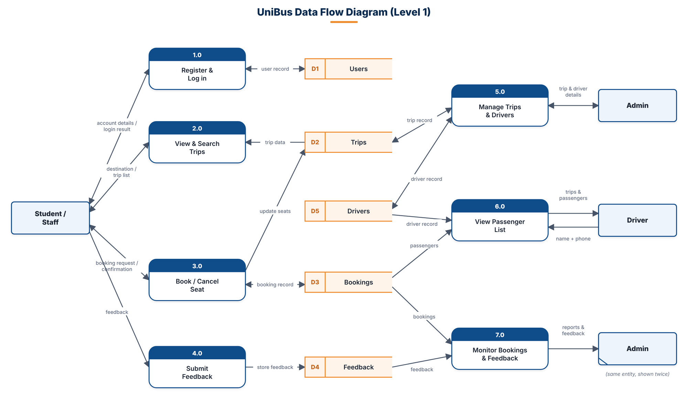 |

<p align="center">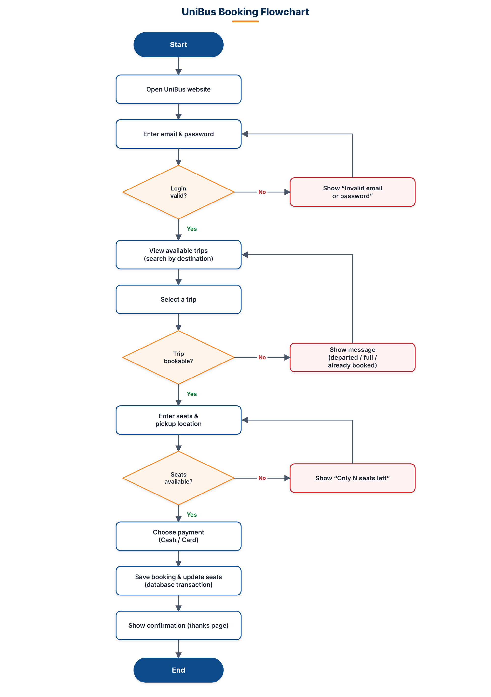</p>

---

## 14. Screenshots

| Available trips | Booking and payment |
|---|---|
| 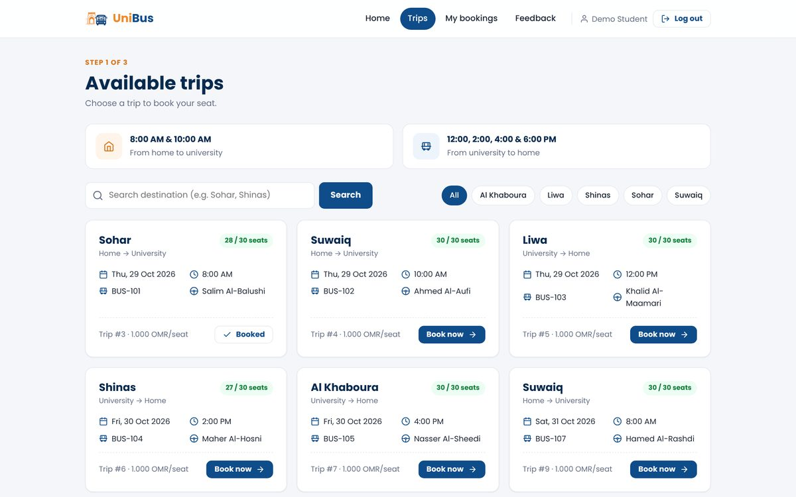 | 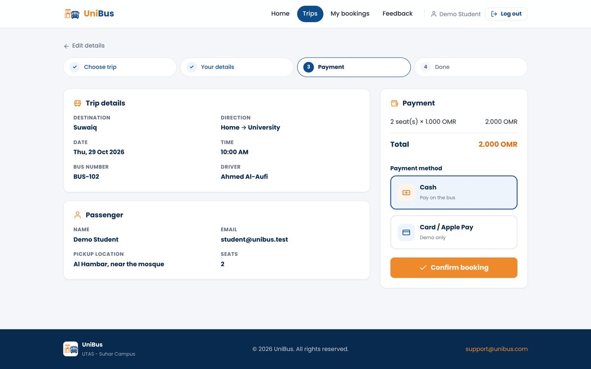 |
| **My bookings** | **Administrator dashboard** |
| 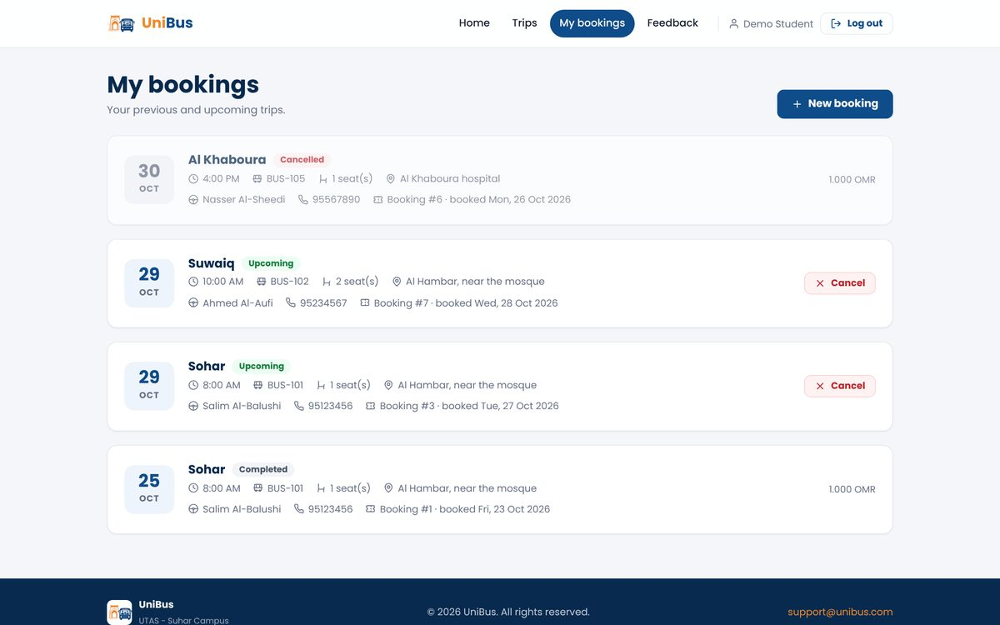 | 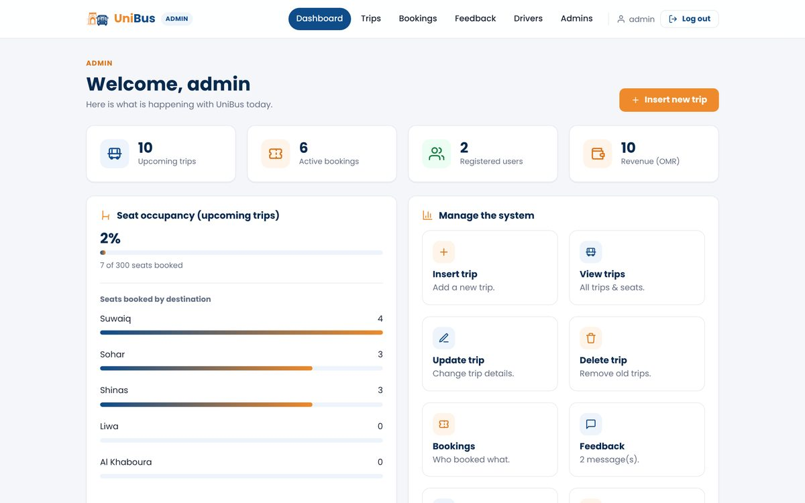 |
| **Trips management** | **Driver – passenger list** |
| 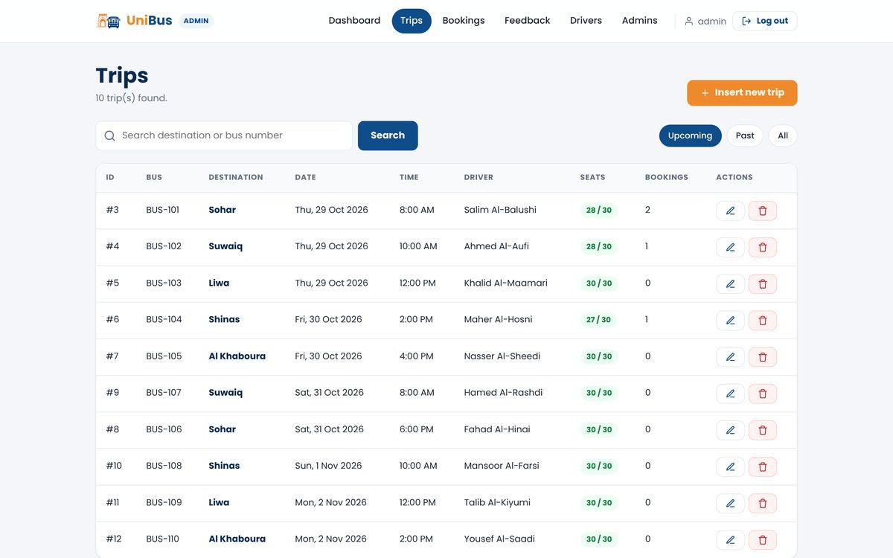 | 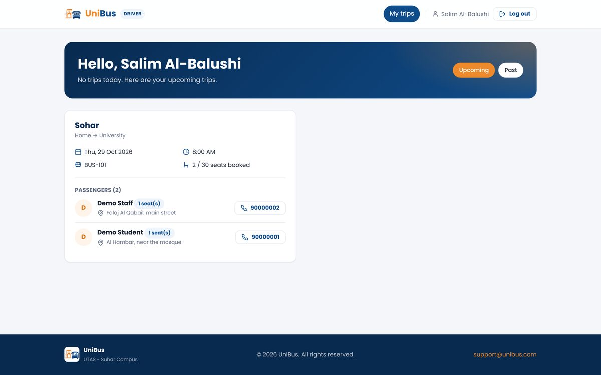 |
| **Drivers management** | **Administrators management** |
| 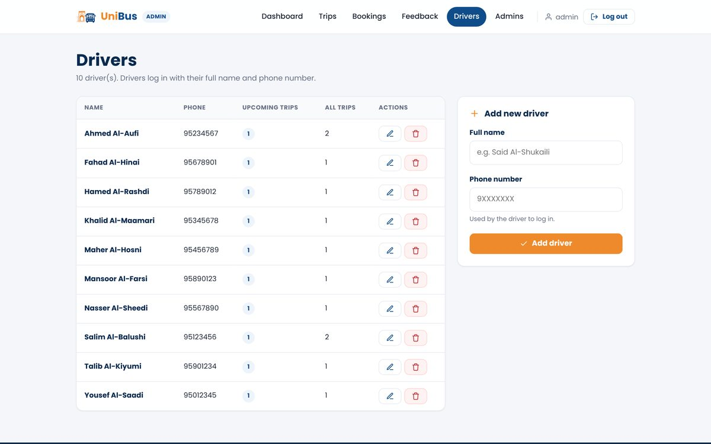 | 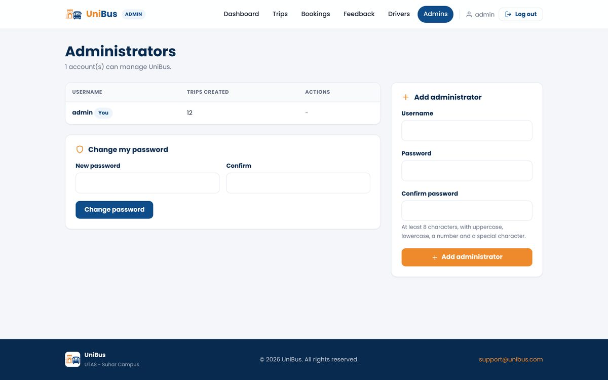 |

<p align="center">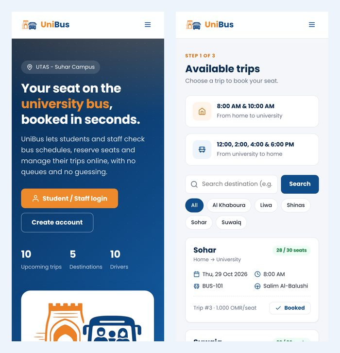</p>

---

## 15. Troubleshooting

| Problem | Solution |
|---|---|
| `php is not recognized` | Close and reopen PowerShell / VS Code. If it still fails, restart the computer. |
| *The PHP pdo_sqlite extension is not enabled* | Complete [Step 3](#step-3--enable-the-required-php-extensions-windows-only). |
| `Call to undefined function mb_strlen()` | The `mbstring` extension is off. Complete [Step 3](#step-3--enable-the-required-php-extensions-windows-only). |
| `Address already in use` | Port 8000 is busy. Run `php -S localhost:8080` and open http://localhost:8080. |
| *Invalid form token* | Refresh the page and submit the form again. |
| Demo data is outdated or broken | Reset the database (see [Database](#10-database)). |
| Fonts look different | The Poppins font loads from the internet; without a connection a system font is used. |

---

## 16. Team

**Software Engineer:** Jumana Albalushi
